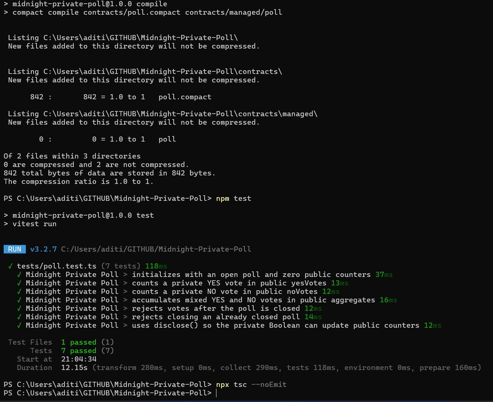
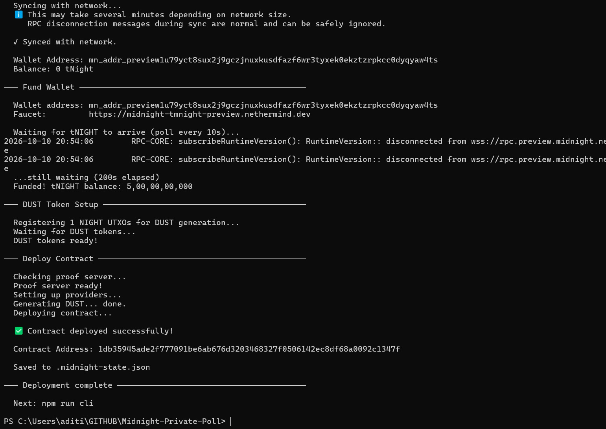

# Midnight Private Poll

[](https://nodejs.org/)
[](https://www.typescriptlang.org/)
[](https://midnight.network/)
[](LICENSE)

A small Midnight Network polling example: a Compact contract accepts YES/NO votes through a witness and maintains public counters and poll status. The repository includes TypeScript deployment and CLI tools, generated contract artifacts, and runtime tests.

## Contents

- [Features](#features)
- [Technology](#technology)
- [Project structure](#project-structure)
- [Product idea](#product-idea)
- [Prerequisites](#prerequisites)
- [Installation](#installation)
- [Configuration](#configuration)
- [Run and deploy](#run-and-deploy)
- [Privacy model](#privacy-model)
- [Screenshots](#screenshots)
- [Deployment](#deployment)
- [Troubleshooting](#troubleshooting)
- [Security](#security)
- [Contributing and license](#contributing-and-license)

## Overview

The implementation provides:

- poll initialization, public tally reads, and poll closure
- witness-backed YES/NO vote submissions
- local and Preview/Preprod deployment scripts

The vote is supplied through a private witness, but each resulting public counter delta can reveal that transaction's YES/NO choice. `disclose()` allows the witness-derived Boolean to select which public counter changes.

## Product idea

Community organizers can run a simple YES/NO poll where the contract publishes auditable totals and open/closed status. A voter's choice is supplied to the circuit as a witness instead of being written as a named ledger field; only the resulting counter update is needed for the tally. Because that update is public per transaction, observers can infer each choice from the ledger.

## Features

- Compact contract with public ledger state: `yesVotes`, `noVotes`, and `isOpen`
- Private witness-based vote input through `localVote()`
- Intentional use of `disclose(vote)` to let a private decision update public counters
- TypeScript wrappers for contract compilation and deployment
- Local devnet support via Docker Compose
- Unit tests covering initialization, vote counting, aggregate tracking, and poll closure rules

## Technology

- Midnight Network Compact language
- Midnight.js 4.1.x runtime and contracts
- TypeScript + Node.js 22
- Vitest for unit testing
- Docker Compose for proof-server and local devnet services; the official Preview/Preprod matrix lists proof-server 8.1.3
- LevelDB-backed private state provider

## Project structure

```text
.
├── contracts/
│   ├── poll.compact
│   └── managed/
│       └── poll/
│           ├── compiler/
│           ├── contract/
│           ├── keys/
│           └── zkir/
├── scripts/
│   ├── compile.mjs
│   └── e2e-check.ts
├── src/
│   ├── check-balance.ts
│   ├── cli.ts
│   ├── compiled-contract.ts
│   ├── deploy.ts
│   ├── network.ts
│   ├── setup.ts
│   ├── wallet-state.ts
│   ├── wallet.ts
│   └── witnesses.ts
├── tests/
│   ├── network.test.ts
│   └── poll.test.ts
├── .compact-version
├── .env.example
├── .gitignore
├── docker-compose.yml
├── package.json
├── package-lock.json
├── README.md
├── screenshots/
│   ├── contract-deployment.png
│   └── test-output.png
├── tsconfig.json
└── LICENSE
```

## Prerequisites

- Node.js 22+
- npm 10+
- Docker Desktop with Compose v2
- Midnight Compact CLI
- Git
- On Windows, WSL2 with Ubuntu; Midnight documents Linux and macOS development, not native Windows development.

## Installation

```bash
git clone https://github.com/yehaditii/Midnight-Private-Poll.git
cd Midnight-Private-Poll
npm install
```

Confirm the Compact CLI is installed in Ubuntu/WSL:

```bash
command -v compact
compact --version
compact compile --version
```

The project pins Compact toolchain `0.31.1`, matching the current official Preview/Preprod support matrix and generated contract metadata. On Windows, install and run Compact inside Ubuntu/WSL using the official installer:

```bash
curl --proto '=https' --tlsv1.2 -LsSf https://github.com/midnightntwrk/compact/releases/latest/download/compact-installer.sh | sh
source ~/.bashrc
compact update 0.31.1
compact --version
compact list --installed
```

If the installer changed your shell PATH, restart the WSL terminal or source the shell config again. Do not use Windows `compact.exe` from `C:\Windows\System32`.

## Configuration

The scripts read configuration from the process environment; they do not load `.env` files automatically. [.env.example](.env.example) lists supported variables for reference. Set any needed values in your shell or configure your IDE to load them, and never commit wallet credentials.

PowerShell example for an optional endpoint override:

```powershell
$env:MIDNIGHT_PROOF_SERVER_URL = "http://127.0.0.1:6300"
```

The following variables are supported:

- `MIDNIGHT_INDEXER_URL`
- `MIDNIGHT_INDEXER_WS_URL`
- `MIDNIGHT_NODE_URL`
- `MIDNIGHT_PROOF_SERVER_URL`
- `MIDNIGHT_FAUCET_URL`
- `MIDNIGHT_BLOCKFROST_PROJECT_ID` (required for default Preprod services)
- `MIDNIGHT_WSL_DISTRO` (optional Windows override; defaults to `Ubuntu`)
- `MIDNIGHT_WALLET_SEED`
- `MIDNIGHT_WALLET_MNEMONIC`
- `PRIVATE_STATE_PASSWORD`
- `MIDNIGHT_FAUCET_TIMEOUT_MS`

The two wallet credential variables are alternatives; do not set both. Preprod's official RPC and indexer use Blockfrost and require a project ID. Set `MIDNIGHT_BLOCKFROST_PROJECT_ID` in the shell, never in a committed file; the network helper adds it to the official endpoint URLs. Alternatively, provide all three explicit RPC/indexer URL overrides. For public-network use, preserve the generated mnemonic securely. Local wallet and deployment state is written to ignored files.

## Run and deploy

### Compile the contract

Run from the repository root in PowerShell or Ubuntu/WSL:

```bash
npm run compile
```

On Windows, [scripts/compile.mjs](scripts/compile.mjs) delegates to Ubuntu/WSL (default distro `Ubuntu`; override with `MIDNIGHT_WSL_DISTRO`) and runs `compact compile +0.31.1 contracts/poll.compact contracts/managed/poll`. Linux and macOS invoke the same command directly. Successful output lists `castVote` and `closePoll` and generates `compiler/`, `contract/`, `keys/`, and `zkir/` under `contracts/managed/poll/`.

### Run the unit tests

```bash
npm test
```

### Start the local proof server and devnet

```bash
docker compose up -d --wait
```

### Start the local CLI for manual interactions

```bash
npm run cli
```

### Deploy to the local or public network

```bash
npm run setup
```

For public Preview or Preprod networks:

```bash
npm run setup -- --network preview
# or
npm run setup -- --network preprod
```

For Preprod, set a valid `MIDNIGHT_BLOCKFROST_PROJECT_ID` in the process environment first. The former `*.preprod.midnight.network` RPC/indexer endpoints were retired on 2026-10-09.

> Deployment is environment-dependent. A working Docker engine must be running before the proof server and contract deployment can proceed.

After deployment, run the interactive CLI to read public tallies, cast a vote, close the poll, or check the wallet balance. The CLI uses the active network and deployment record in the local ignored state file.

```bash
npm run cli
npm run check-balance
```

## Privacy model

The design intentionally separates public state from private witness data.

- `yesVotes` and `noVotes` are public ledger values.
- `isOpen` is public ledger state.
- `localVote()` supplies a private witness value to the circuit; the Boolean is not stored as a named ledger field.
- `disclose(vote)` explicitly permits that value to determine which public counter is incremented.

This is not ballot secrecy or anonymity: because the public counters change with each vote, an observer can infer the YES/NO choice from the transaction's counter delta. The implementation also does not provide duplicate-vote prevention.

## Screenshots

These screenshots capture the successful validation steps from the verified environment. The compile step was validated via terminal output and is not represented by a saved image file in this repository.





## Deployment

The deployment was independently verified on 2026-10-11 with the project's read-only `npm run test:e2e` check against the official Preview indexer. Rerun this read-only check after future deployments.

- Network: Preview
- Contract address: `1db35945ade2f777091be6ab676d3203468327f0506142ec8df68a0092c1347f`

The address matches the local ignored deployment record and the owner-supplied deployment output. The read-only E2E check confirmed it is indexed and queryable. No explorer-specific address URL is included because its URL format has not been verified.


```bash
npm run test:e2e
```

## Troubleshooting

- **Windows compile cannot start WSL:** install/register Ubuntu under WSL2, or set `MIDNIGHT_WSL_DISTRO` to the distro containing the Compact CLI.
- **PowerShell prints compression statistics after calling `compact` directly:** Windows resolved that direct command to its built-in file-compression utility. Use `npm run compile`, which delegates to WSL, or run Compact from Ubuntu/WSL.
- **Compact reports no compatible compiler:** run `compact update 0.31.1`, then compile with `compact compile +0.31.1 ...`.
- **Docker cannot connect to the engine:** start Docker Desktop with its Linux engine before `docker compose up -d --wait` or `npm run setup`.
- **Proof server is unavailable:** inspect `docker compose ps` and `docker compose logs proof-server`; deployment requires a reachable proof server.
- **Public deployment has no funds:** fund only the generated test wallet using the faucet printed by the network configuration. Never share the recovery phrase.
- **Preprod RPC/indexer authentication fails:** Preprod moved to Blockfrost on 2026-10-09. Set `MIDNIGHT_BLOCKFROST_PROJECT_ID`; do not use the retired `*.preprod.midnight.network` endpoints.

## Security

- `.midnight-state.json` contains wallet seed/recovery material and deployment records; it is ignored and must stay private.
- `.midnight-wallet-state/` and `midnight-level-db/` hold local wallet/private state and are ignored.
- `.env.example` is reference-only; the scripts read process environment variables and do not load `.env` files automatically.
- Blockfrost project IDs, wallet credentials, and private-state passwords are secrets; keep them in process environment or a local secrets manager.
- Generated proving/verifying keys and ZKIR in `contracts/managed/poll/` are compiler outputs needed for contract use, not wallet credentials.
- This poll does not provide anonymity, secrecy against observers of individual tally deltas, or duplicate-vote prevention.

## Development notes

The main contract lives in [contracts/poll.compact](contracts/poll.compact). The generated artifacts in [contracts/managed/poll](contracts/managed/poll) are compiler output and should not be edited by hand.

Relevant TypeScript entry points:

- [src/deploy.ts](src/deploy.ts) — deployment logic
- [src/network.ts](src/network.ts) — network and wallet configuration
- [src/witnesses.ts](src/witnesses.ts) — local vote witness implementation
- [src/compiled-contract.ts](src/compiled-contract.ts) — compiled contract binding
- [tests/poll.test.ts](tests/poll.test.ts) — contract behavior tests
- [tests/network.test.ts](tests/network.test.ts) — network endpoint and credential configuration tests

## Official references

- [Midnight toolchain installation](https://docs.midnight.network/getting-started/installation)
- [Preview and Preprod compatibility matrix](https://docs.midnight.network/relnotes/support-matrix)
- [Current network endpoints](https://docs.midnight.network/relnotes/network)
- [Compact CLI documentation](https://github.com/LFDT-Minokawa/compact/blob/main/doc/dev-tool-usage.mdx)

## Contributing and license

Contributions are welcome if they preserve the current functionality and improve documentation, correctness, or maintainability.

1. Fork the repository.
2. Create a topic branch.
3. Make a focused change.
4. Run the relevant validation commands.
5. Open a pull request with a clear description of the change.

Do not submit secrets, private keys, wallet mnemonics, or real environment values in pull requests.

Preview the README locally with VS Code's Markdown preview (`Ctrl+Shift+V`) or open the repository README in GitHub's rendered view.

This project is distributed under the MIT License; see [LICENSE](LICENSE). Midnight is the underlying network and toolchain used by the project.
